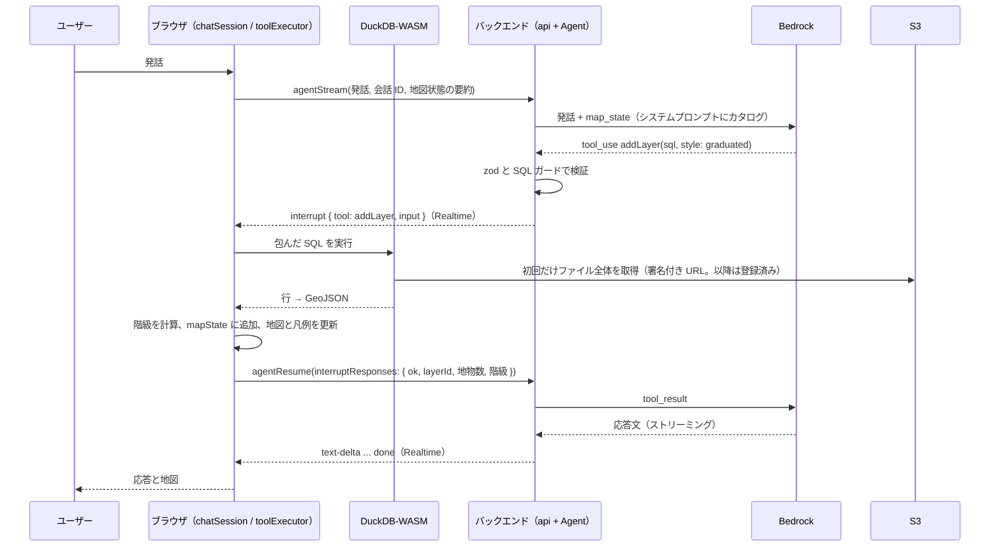

# 詳細設計書 - チャットで主題図を作る AI Web マップ

要件は `.tmp/requirements.md` を参照する。本書中の「未検証」は、実装冒頭のスパイク（10.1）で確かめる項目を指す。

## 1. アーキテクチャ概要

### 1.1 システム構成図

```
[データ準備（開発者の PC で 1 回）]
  国土数値情報の ZIP ──▶ scripts/data/convert.ts（ネイティブ DuckDB + spatial）
                              ├─▶ data/dist/*.parquet（GeoParquet, zstd）──▶ FileBucket（S3）
                              └─▶ shared/catalog.json（リポジトリに含める）

[ブラウザ: SvelteKit 静的 SPA]
  ┌──────────────────────────────────────────────────────────────┐
  │ 上部バー: タイトル / アカウントメニュー /（フェーズ 2）保存・開く │
  │ ┌────────────┐                              ┌──────────────┐ │
  │ │ LayerPanel │      MapView（全面）          │  ChatPanel   │ │
  │ │ 左・重ねる │      MapLibre GL JS           │  右・ドック  │ │
  │ │ 凡例 / SQL │                              │  折りたたみ可│ │
  │ └────────────┘            出典表示           └──────────────┘ │
  └──────────────────────────────────────────────────────────────┘
     mapState（単一の状態）◀── toolExecutor ◀── chatSession（createChat）
            │                      │                    ▲ │
            ▼                      ▼                    │ │ 型付きクライアント
     styleCompiler / legend   DuckDB-WASM + spatial     │ │ + Realtime
                                   │ 全体取得（初回） │ ▼
                                   ▼               [AWS Blocks バックエンド]
                         S3 の署名付き URL ◀─────── api（ApiNamespace）
                                                    ├ AuthBasic
                                                    ├ Agent（Bedrock Claude Haiku 5.5）
                                                    ├ Realtime（Agent のチャンク配信）
                                                    ├ FileBucket（datasets）
                                                    ├ AppSetting（利用許可ユーザー）
                                                    └ DistributedTable（maps, フェーズ 2）
```

要点は 3 つある。

1. **SQL はブラウザだけで実行する。** サーバーは SQL を実行しない。
2. **Agent のツールはサーバーで動くが、実処理はブラウザに委譲する。** ツールのハンドラーはカスタム interrupt を出すだけで、ブラウザが実行結果を `resume` で返す。
3. **地図の状態は `mapState` に一本化する。** レイヤーは「SQL + スタイル指定」で定義し、地物データは再クエリで再現できるものとして扱う。

### 1.2 技術スタック

- 言語: TypeScript 5.9（`any`、`unknown`、`class` は使わない）
- フロントエンド: SvelteKit（Svelte 5、`adapter-static`、`ssr = false`）、Tailwind CSS v4
- 地図: MapLibre GL JS 6.18 + `svelte-maplibre-gl` 2.2（`ViteAdapter` は 2.2.1 に存在しない。副作用 import の `svelte-maplibre-gl/vite` を使い、`vite.config.ts` に `optimizeDeps.exclude: ['svelte-maplibre-gl']` が要る。Task 0.7 で変更）
- クエリ: `@duckdb/duckdb-wasm` 1.32.0（固定。エンジンは v1.4.3、`eh` バンドル。`latest` タグは開発ビルドなので使わない。Task 0.7 で確定）+ spatial 拡張
- バックエンド: `@aws-blocks/blocks`（`AuthBasic`、`Agent`、`Realtime`、`FileBucket`、`AppSetting`、`DistributedTable`）。`createChat` の import 元の `@aws-blocks/bb-agent` は、直接の依存として宣言する（Task 0.7 で追記）
- LLM: Amazon Bedrock の Claude Haiku 5.5。モデル ID `jp.anthropic.claude-haiku-5-5`（`jp.` 推論プロファイル）を `shared/config.ts` に 1 か所だけ書き、`model.local` と `model.deployed` の両方に明示する。ローカルも Bedrock。Blocks の定数（`BALANCED`、`FAST`）は `global.` プロファイルを指し、組織の SCP で拒否されるので使わない（Task 0.7 で変更。ユーザーの決定）
- スキーマ: zod 4（バックエンドとフロントエンドで共有）
- テスト: vitest（追加する。単体）、既存の `npm run test:e2e`（`node:test`）、Playwright MCP（実ブラウザ確認）
- データ変換: ネイティブ DuckDB（CLI または `@duckdb/node-api`）+ spatial

## 2. コンポーネント設計

### 2.1 コンポーネント一覧

| コンポーネント | 場所 | 責務 | 依存関係 |
|---|---|---|---|
| 共有定義 | `shared/` | スキーマ、ツール規約、SQL ガード、カタログ、設定値、プロンプト生成。純粋な TypeScript | zod |
| バックエンド | `aws-blocks/index.ts` | 認証、署名付き URL の発行、Agent とツール定義、会話 API、（フェーズ 2）地図の保存 | 共有定義、Blocks |
| DuckDB エンジン | `src/lib/duckdb/` | 初期化、データ登録、SELECT 実行、GeoJSON への変換 | duckdb-wasm、共有定義 |
| 地図状態 | `src/lib/map/mapState.svelte.ts` | レイヤーと視点の状態、変更操作 | 共有定義 |
| スタイル変換 | `src/lib/map/styleCompiler.ts` ほか | スタイル指定 → 階級・配色の解決 → MapLibre の式、凡例モデル | 共有定義 |
| ツール実行 | `src/lib/chat/toolExecutor.ts` | interrupt で届いたツール要求をブラウザで実行し、結果を作る | DuckDB エンジン、地図状態、スタイル変換 |
| チャット接続 | `src/lib/chat/chatSession.svelte.ts` | `createChat` の配線、interrupt の受信と応答、地図状態の添付 | `aws-blocks`、ツール実行 |
| UI | `src/lib/components/` | `MapView`、`LayerPanel`、`Legend`、`ChatPanel` など | 上記すべて |
| データ変換 | `scripts/data/` | 国土数値情報 → GeoParquet とカタログ、アップロード | ネイティブ DuckDB |

`shared/` はリポジトリ直下に置く。フロントエンドもバックエンドも相対パスで読み込む。デプロイ済みのバックエンドのバンドルが `aws-blocks/` の外の `shared/` を設定変更なしで取り込めることを、スパイク B-2 で確認した。フロントエンドからの相対 import、型検査、ビルドも設定変更なしで通った。したがって `$shared` の別名は設けない（Task 0.7 で変更）。

Todo テンプレートのコード（テーブル、API、`TodoList.svelte`、テスト）は削除する。

### 2.2 各コンポーネントの詳細

#### 共有定義（`shared/`）

- **目的**: バックエンドとフロントエンドのずれを防ぐ。定義は 1 か所に置く。
- **公開インターフェース**:

```typescript
// shared/mapSpec.ts — すべて zod スキーマから型を導出する
type GeometryFamily = 'point' | 'line' | 'polygon';
type HexColor = string; // /^#[0-9a-fA-F]{6}$/

interface StyleCommon {
  opacity?: number;        // 0–1
  strokeColor?: HexColor;  // 枠線（点・面）
  strokeWidth?: number;
  size?: number;           // 点の半径、線の太さ（px）
}

type StyleSpec = StyleCommon & (
  | { type: 'single'; color: HexColor }
  | { type: 'categorized'; column: string; palette?: QualitativePalette;
      overrides?: Record<string, HexColor> }          // 例: { "JR": "#e60012" }
  | { type: 'graduated'; column: string; method: 'quantile' | 'equal' | 'manual';
      classes?: number; breaks?: number[]; palette?: SequentialPalette; reverse?: boolean }
  | { type: 'proportional'; column: string; color: HexColor;
      minRadius?: number; maxRadius?: number }         // 点のみ
);

interface LabelSpec {
  column: string;
  size?: number;
  color?: HexColor;
  haloColor?: HexColor;
  haloWidth?: number;
  minZoom?: number;
}

type ViewTarget =
  | { type: 'layer'; layerId: string }
  | { type: 'bbox'; bbox: [number, number, number, number] }
  | { type: 'center'; center: [number, number]; zoom: number }
  | { type: 'query'; sql: string };  // geom を返す SQL の範囲へ移動（地名での移動に使う）
```

```typescript
// shared/toolProtocol.ts
type ToolName = 'runQuery' | 'addLayer' | 'setLayerStyle' | 'setLayerLabel' | 'removeLayer' | 'setView';

interface ClientToolRequest { tool: ToolName; input: ToolInput }   // interrupt の reason

type ToolErrorCode =
  | 'SQL_REJECTED' | 'SQL_ERROR' | 'TIMEOUT' | 'TOO_MANY_FEATURES' | 'NO_GEOMETRY'
  | 'MIXED_GEOMETRY' | 'UNKNOWN_COLUMN' | 'UNKNOWN_LAYER' | 'INVALID_STYLE'
  | 'ENGINE_UNAVAILABLE' | 'SESSION_RESET';

type ClientToolResult<T> =
  | { ok: true; data: T }
  | { ok: false; error: { code: ToolErrorCode; message: string; hint?: string } };

function interruptName(tool: ToolName): string; // `client:${tool}`（ツールごとの固定。Task 0.7 で変更）
```

```typescript
// shared/sqlGuard.ts
type SqlGuardResult = { ok: true; sql: string; tables: string[] } | { ok: false; reason: string };
function validateSql(sql: string, knownTables: readonly string[]): SqlGuardResult;

// shared/catalog.ts
interface CatalogColumn {
  name: string; type: 'string' | 'number' | 'boolean'; description: string; unit?: string;
  stats?: { min: number; max: number };
  topValues?: { value: string; count: number }[];
}
interface CatalogDataset {
  id: string;                 // DuckDB のビュー名を兼ねる（例: 'stations'）
  title: string; description: string; file: string;
  geometryType: GeometryFamily; featureCount: number; bbox: [number, number, number, number];
  source: { name: string; url: string; year: string; license: string };
  columns: CatalogColumn[]; notes?: string[];
}

// shared/prompt.ts
function buildSystemPrompt(catalog: readonly CatalogDataset[]): string;

// shared/config.ts — 上限値、タイムアウト、ベースマップ URL などを 1 か所に集める（9.2）
```

- **内部実装方針**:
  - `interruptName` はツールごとの固定名（`client:${tool}`）にする。interrupt の `id` には `toolUseId` が入る（`tool:<toolUseId>:<name>`）ので、同じ入力を順番に 2 回、並列に 2 回呼んでも衝突しないことをスパイク A で確認した。ブラウザは `name` ではなく `interruptId` で応答と対応させる。1 つのハンドラーの中で `interrupt()` を複数回呼ばない（`id` が同じになり衝突する見込み。未確認）。（Task 0.7 で変更。当初は入力のハッシュを名前にしていた）
  - 応答（`response`）はサーバーで `String()` にされる。ブラウザは `ClientToolResult` を JSON 文字列にして返し、ハンドラーが `JSON.parse` して zod で検証する。ハンドラーは `interrupt()` を呼ぶだけで、前に副作用を置かない（再開のたびに先頭から再実行されることを、カウンターで確認した）。
  - SQL ガードは、コメントと文字列リテラルを取り除いたうえで判定する。許可するのは `SELECT` または `WITH` で始まる単文だけとする。DDL・DML、`ATTACH`、`COPY`、`INSTALL`、`LOAD`、`SET`、`PRAGMA`、`read_*`、`*_scan`、`glob`、`ST_Read` を拒否する。文字列リテラルに `://` やデータファイルの拡張子を含む場合も拒否する。誤検知は許容する。
  - システムプロンプトにカタログ全体（列の説明、統計値、上位の値）を埋め込む。LLM が下調べのクエリなしで `addLayer` を直接呼べるようにし、往復回数を減らす。`systemPrompt` は起動時の固定文字列なので、カタログはリポジトリに含める（S3 には置かない。要件 2.1 からの変更点）。

#### バックエンド（`aws-blocks/index.ts`）

- **目的**: 認証、データ URL の発行、LLM の実行。SQL とスタイルの処理は持たない。
- **公開インターフェース**: 4.1 を参照。
- **内部実装方針**:
  - 6 つのツールは同じ形で定義する。入力を zod で検証し（SQL を含むツールは `validateSql` も実行）、問題がなければ interrupt を出す。検証エラーはブラウザを経由せず LLM に返るので、往復を 1 回節約できる。

```typescript
// ツール定義の形（設計上のスケッチ）
addLayer: tool({
  description: '...',
  parameters: addLayerInputSchema,
  handler: async ({ input, interrupt }) => {
    const guard = validateSql(input.sql, datasetIds);
    if (!guard.ok) return toolError('SQL_REJECTED', guard.reason);
    const raw = await interrupt<string>({          // 応答は JSON 文字列で届く（Task 0.7 で変更）
      name: interruptName('addLayer'),
      reason: { tool: 'addLayer', input },
    });
    return parseClientToolResult(raw, addLayerDataSchema);   // JSON.parse + zod。失敗は toolError にする
  },
}),
```

  - `streamingMode: 'token'`、`maxLlmCalls` と `maxToolIterations` は設定値（初期値 24。Task 0.7 で 12 から変更）とする。上限は再開をまたいで数えられる。順番の単独のツール呼び出しでは 1 回につき両方が 1 ずつ消費された（並列の呼び出しでの消費は未確認。1 ターンのモデル呼び出しはツールの往復の数 + 1）（スパイク A）。ライブラリの既定は 20。超えると `error` チャンクが届き、`done` は来ない。
  - `model.deployed` と、`AGENT_LOCAL_MODEL` が `bedrock` のときの `model.local` は、`{ provider: 'bedrock', modelId: <shared/config.ts のモデル ID> }` を明示する（`jp.anthropic.claude-haiku-5-5`。Task 0.7 で追記）。`model.local` は環境変数 `AGENT_LOCAL_MODEL`（`bedrock` | `canned`、既定 `bedrock`）で切り替える。E2E テストは `canned` を使う。`canned` はツール呼び出し → interrupt → 再開 → 固定文の 1 往復までで、入力はスキーマの placeholder になる（`cannedExamples` で変えられる）。
  - `datasets` バケットは `versioned: false` とし、CORS は `GET`/`HEAD`、全オリジンにする（6.2）。データは全体取得なので、`Range` ヘッダーの許可と `Content-Range` などの公開は不要（Task 0.7 で変更）。バケットには GeoParquet に加えて、DuckDB-WASM の wasm（`eh`）を置く。

#### DuckDB エンジン（`src/lib/duckdb/`）

- **目的**: ブラウザ内でのクエリ実行を 1 つのモジュールに閉じ込める。
- **公開インターフェース**:

```typescript
type EngineStatus =
  | { state: 'idle' } | { state: 'loading'; step: string }
  | { state: 'ready'; duckdbVersion: string }   // accessMode は廃止（全体取得だけ。Task 0.7 で変更）
  | { state: 'error'; message: string };

interface ColumnInfo { name: string; type: 'string' | 'number' | 'boolean' | 'other' }

interface LayerQueryResult {
  features: GeoJSON.FeatureCollection;
  geometryType: GeometryFamily;
  columns: ColumnInfo[];
  featureCount: number;
  bbox: [number, number, number, number];
}
interface TableQueryResult { columns: ColumnInfo[]; rows: JsonRow[]; truncated: boolean }

function initEngine(onStatus: (s: EngineStatus) => void): Promise<void>;
function queryLayer(sql: string): Promise<ClientToolResult<LayerQueryResult>>;
function queryTable(sql: string, maxRows: number): Promise<ClientToolResult<TableQueryResult>>;
```

- **内部実装方針**:
  - 初期化は、Worker を Vite の `?url` インポートで、wasm（`eh`、約 34 MB）をアプリのバケットから署名付き URL（`getDatasetSources` が返す）で読み込む。使うバンドルは `eh` だけにする（対象は最新の Chrome）。続けて `INSTALL spatial; LOAD spatial;` を実行する。実測（スパイク B）: 初回の初期化はバケットから読んで中央値 2,575 ms（同じページでの再初期化 1,562 ms）、ローカルの開発サーバーで 3,147 ms（最大 5,405 ms）。wasm は署名付き URL のためキャッシュされず、開くたびに約 34 MB を取り直す。（Task 0.7 で変更。ホスト型プレビューの前面は 34 MB の wasm を返せず HTTP 500 になったため。ローカルのモックでも同じ経路にして、コードを 1 本にする。ただしスパイクのローカル計測は Vite の `?url` で、モックのバケットからの配信は試していない。wasm のオブジェクト名にはバージョンを含め、インストール済みのパッケージの版から導く。CloudFront 前面からのアプリのオリジンでの配信は未確認で、本番のホスティングを最初に行うときに測り直す）。wasm の URL は初期化（再初期化を含む）のたびに取り直す（下の「署名付き URL の再発行の規則」）
  - 設定の固定は、必要な `SET`（`threads`、`memory_limit` など）をすべて済ませてから `SET lock_configuration = true` を実行する。lock 後も `registerFileBuffer` と `CREATE VIEW` はできるが、`SET` は拒否される。lock は `LOAD`、`INSTALL`、外部 URL の読み取り、`COPY TO` を**止めない**ので、ユーザー（LLM）の SQL の防御は SQL ガード（`shared/sqlGuard.ts`）に頼る。`SET enable_external_access = false` の単独の併用は、登録済みバッファが読めなくなるので使えない。`allowed_paths` / `allowed_directories` / `disabled_filesystems` の効果は未確認で、Task 2.2 で確かめる（Task 0.7 で追記）。
  - データセットは、署名付き URL を `fetch` してファイル全体を取得し、`registerFileBuffer` で登録する。`CREATE VIEW <id> AS SELECT ... FROM read_parquet('<file>')` でビューにする。LLM はビュー名だけを使う。SQL に現れたビュー名を見て、必要なデータセットだけを遅延登録する。各ファイルはセッションごとに 1 回だけ取得して登録したままにする（署名付き URL は発行のたびに違うので、HTTP キャッシュには頼らない）。`registerFileBuffer` は渡したバッファを転送（detach）するので、`terminate` 後の再登録用に複製を控える。（Task 0.7 で変更）
  - **Range 読み取りは使わない。** 当初は Range 読み取りと全体取得を自動判定する設計だった（Task 0.7 で変更）。スパイク B-2 で、署名付き URL では `registerFileURL` の設定だけでは Range 読み取りに入れないことがわかった。DuckDB-WASM 1.32.0 は、サイズを知るために `Range: bytes=0-` の HEAD を送り、206 と `Content-Length` で答えたときだけ Range 読み取りに入る。署名付き GET URL の HEAD は 403 で、`bytes=0-0` の GET の応答からは `Content-Range` を読まない（`Content-Length` を `/` で分割する）。検証用ファイルは最大でも 4,394,714 B（約 4.4 MB）で、DuckDB の全体読み込みは 1 クエリ 189〜398 ms（`fetch` での取得もほぼ同じと見込む【推定】）のため、全体取得に統一する。
  - 今は採用しない代替案（ファイルが数十 MB になったら見直す）: Worker 内で HEAD を `GET Range: bytes=0-0` に置き換える方式（動くが、3〜4 MB では全体取得より遅く、1.32.0 の内部に依存する）と、`Range: bytes=0-` の HEAD に 206 + `Content-Length` で答える配信経路（CloudFront など。未検証）。
  - 行グループの大きさと並び順は、全体取得では性能に効かない。既定は 2,048 行、点データは `muni_code` 順、zstd のままにする（2.2 のデータ変換）。
  - レイヤー用の SQL は `SELECT * EXCLUDE (geom), ST_AsGeoJSON(geom) AS __geojson FROM (<sql>) LIMIT <上限 + 1>` で包む。結果は `geom` 列を 1 つ持つことを規約とする。
  - `BIGINT` や `DECIMAL` は JavaScript の数値に変換する。Multi 系のジオメトリは点・線・面の 3 系統に丸め、混在は `MIXED_GEOMETRY` で拒否する。
  - タイムアウトとキャンセルは、クエリを `conn.send()` で投げ、期限（30 秒）で `conn.cancelSent()` を呼ぶ。`conn.query()` のクエリは `cancelSent()` で止まらない。`cancelSent()` は止まるまで 12〜18 秒かかった（遅いクエリ 1 種類での測定）ので、猶予（初期値 5 秒）内に返らなければ `worker.terminate()` で Worker を捨て、再初期化と再登録をする（約 1.6 秒。取得済みのデータファイルは控えた複製から再登録するので、再ダウンロードも URL も要らない。wasm は再取得が要る。URL の規則は下を参照）。結果の GeoJSON が大きいときは JS 側の変換（学校 5.7 万点で約 0.4 秒）も同じスレッドで走る。（Task 0.7 で変更。当初は「未検証」）
  - **署名付き URL の再発行の規則**（Task 0.7 で追記）: 署名付き URL の有効期限は 1 時間で、wasm とデータファイルの両方が `getDatasetSources` の URL を使う。エンジンの初期化の前（`terminate` 後の再初期化と、初期化の再試行を含む）は毎回 `getDatasetSources` を呼び直す。データファイルの遅延取得の前は、保持している URL が `expiresAt` を過ぎている、または近いときに呼び直す。取得が 403 になったら、取り直して 1 回だけ再試行する。すでに取得したデータファイルは控えた複製から再登録でき、URL は要らない。5.1 と Task 2.2・2.3 はこの規則を参照する。

#### 地図状態（`src/lib/map/mapState.svelte.ts`）

- **目的**: レイヤー一覧、凡例、地図描画、LLM への状態通知の唯一の情報源。
- **公開インターフェース**:

```typescript
interface LayerState {
  id: string;               // 'L1', 'L2', ...（LLM が参照しやすい短い ID）
  name: string;
  sql: string;
  geometryType: GeometryFamily;
  columns: ColumnInfo[];
  featureCount: number;
  bbox: [number, number, number, number];
  visible: boolean;
  style: StyleSpec;
  label: LabelSpec | null;
  resolved: ResolvedStyle;  // 階級の境界、カテゴリと色の対応（凡例と描画が共有する）
  status: 'ready' | 'loading' | 'error';
  errorMessage?: string;
}
interface MapState { view: { center: [number, number]; zoom: number }; layers: LayerState[]; nextLayerSeq: number }

const mapState: MapState;                                   // $state
function addLayer(input: NewLayer, data: LayerQueryResult): LayerState;
function replaceLayer(layerId: string, input: NewLayer, data: LayerQueryResult): LayerState;
function setStyle(layerId: string, style: StyleSpec): ClientToolResult<LayerState>;
function setLabel(layerId: string, label: LabelSpec | null): ClientToolResult<LayerState>;
function removeLayer(layerId: string): boolean;
function setVisible(layerId: string, visible: boolean): void;
function summarizeForLlm(): MapContext;                     // LLM に渡す要約（地物は含めない）
function toPersisted(): PersistedMapState;                  // フェーズ 2。地物と resolved を除く
```

- **内部実装方針**: 関数とルーンで実装する（`class` は使わない）。地物データは大きいので `$state.raw` で持ち、深いリアクティビティの対象から外す。描画順はジオメトリの系統（面 → 線 → 点 → ラベル）、同じ系統内は追加順とする。

#### スタイル変換（`src/lib/map/`）

- **目的**: 意味レベルのスタイル指定を、MapLibre の式と凡例に変換する。
- **公開インターフェース**:

```typescript
// classify.ts
function computeBreaks(values: number[], method: 'quantile' | 'equal', classes: number): number[];

// styleCompiler.ts
function resolveStyle(style: StyleSpec, geometryType: GeometryFamily,
                      features: GeoJSON.FeatureCollection): ClientToolResult<ResolvedStyle>;
function toMapLibreLayers(layer: LayerState): MapLibreLayerProps[];  // fill / line / circle / symbol

// legend.ts
type LegendModel =
  | { type: 'single'; color: HexColor }
  | { type: 'categorized'; column: string; items: { label: string; color: HexColor }[] }
  | { type: 'graduated'; column: string; items: { min: number; max: number; color: HexColor }[] }
  | { type: 'proportional'; column: string; color: HexColor; items: { value: number; radius: number }[] };
function toLegend(layer: LayerState): LegendModel;
```

- **内部実装方針**:
  - すべて純粋関数とする。階級の境界は、読み込み済みの地物から JavaScript で計算する（追加のクエリは不要。ブレインストーミング時の「DuckDB で計算」からの変更点）。
  - カテゴリは件数の多い順に上限（初期値 12）まで色を割り当て、残りは「その他」にまとめる。
  - 配色は名前付きの固定セットとする。連続系（`blues`、`greens`、`reds`、`oranges`、`purples`、`ylorrd`、`viridis`）とカテゴリ系（`set2`、`tableau10`、`paired`）を用意する。
  - 比例シンボルは面積が値に比例するよう、半径を平方根で補間する。
  - 列が存在しない、数値でない、点以外に比例シンボルを指定した、などは `UNKNOWN_COLUMN` や `INVALID_STYLE` を返し、LLM に修正させる。

#### ツール実行（`src/lib/chat/toolExecutor.ts`）

- **目的**: `ClientToolRequest` を受け取り、ブラウザで実行して `ClientToolResult` を返す。
- **公開インターフェース**:

```typescript
function executeClientTool(request: ClientToolRequest): Promise<ClientToolResult<ToolData>>;
```

- **内部実装方針**: 入力を共有スキーマで再検証する（Realtime 経由のデータを信用しない）。例外は外に出さず、必ず `ok: false` の結果にする。LLM に返す結果は小さく保つ（上限は設定値、初期値 16 KB。応答の JSON 文字列の UTF-8 バイト数で数える）。地物そのものは返さない。クエリの結果はブラウザに残し、モデルには列、件数、先頭の行、階級などの要約だけを返す。1 回の `sendMessage` でまとめて返す全件の合計にも上限を置く（初期値 64 KB）。根拠: 実測した応答の上限は約 200 KB（ASCII。日本語や JSON の `"` では文字数の上限がさらに低い）で、応答は `approval` 行に 2 回保存され、1 行 400 KB が上限になる。デプロイ後の転送の上限は未確認（Task 5.3 で確かめる）。上限を超える場合は、行数を減らして要約を作り直す。（Task 0.7 で追記）

| ツール | 入力 | 成功時に LLM へ返す内容 |
|---|---|---|
| `runQuery` | `sql` | 列、先頭の行（上限 50 行、ジオメトリは型名に置換）、打ち切りの有無 |
| `addLayer` | `name`, `sql`, `style?`, `label?`, `replaceLayerId?`, `zoomTo?` | レイヤー ID、地物数、ジオメトリ種別、列、範囲、適用した階級やカテゴリ |
| `setLayerStyle` | `layerId`, `style` | 適用した階級やカテゴリ |
| `setLayerLabel` | `layerId`, `label`（`null` で解除） | 適用結果 |
| `removeLayer` | `layerId` | 残りのレイヤー ID |
| `setView` | `target: ViewTarget` | 移動後の中心とズーム |

表示・非表示の切り替えはパネルだけの操作とし、ツールにはしない。

#### チャット接続（`src/lib/chat/chatSession.svelte.ts`）

- **目的**: `createChat` と `realtimeTransport` を配線し、interrupt をツール実行につなぐ。
- **公開インターフェース**:

```typescript
interface ChatSession {
  readonly messages: ChatMessage[];
  readonly isLoading: boolean;         // 自前の処理中状態。createChat の loading は使わない（下記）
  readonly activity: ToolActivity[];   // 「クエリ実行中」などの表示用
  readonly error: string | null;
  send(text: string): Promise<void>;
  reset(): void;
}
function createChatSession(): ChatSession;
```

- **内部実装方針**:
  - `onInterrupt` で届いた配列は、実行は並列でよいが、全件の結果がそろってから 1 回の `sendMessage({ interruptResponses })` でまとめて返す（片方だけ返すと残りだけが再度届く）。結果は JSON 文字列にして返す。再接続や再読み込みでの再通知に備え、処理済みの interrupt ID を記録して重複を無視する。再開のたびに `tool-call` チャンクが再送されるので、`activity` の件数は重複を除いて数える。
  - **処理中の状態は `chatSession` が自前で持つ。** `onInterrupt` の中で即座に返すと、再開の途中で `createChat` の `loading` が `false` に戻り、`sendMessage` の二重送信ガードが効かない（スパイク A。2 回目の送信が通り、1 回目の再開のチャンクが画面に届かなくなったり、再開が二重に走ったりした）。送信から `done` / `error` まで、および保留中の interrupt がある間は、入力をブロックする。`error` チャンクが来ず `onError` だけが呼ばれる失敗（`resume` の RPC の拒否など）でも、処理中の状態を終える。（Task 0.7 で追記）
  - 送信時に `summarizeForLlm()` の結果を API に渡す。バックエンドが発話の末尾に `<map_state>` ブロックとして付ける。表示時はこのブロックを取り除く。
  - 地図状態と対応しない保留中の interrupt（再読み込み後など）には `SESSION_RESET` を返す。保留中の interrupt を「捨てる」手段は Agent ブロックにない（保留中に新しいメッセージを送ると、`getPendingInterrupts` から見えなくなるが、古い ID では再開できる）。そこで、保留があるうちは新しいメッセージを送らせず、捨てたいときは全件に `SESSION_RESET` を返す。モデルはエラーのツール結果を受け取るだけで別のツールを呼ぶ可能性があり、ターンが終わるかは未確認（Task 4.5 で確かめる）。捨てたターンで続けて呼ばれたツールにも `SESSION_RESET` を返す。会話を作り直すときは新しい会話 ID にする。ブラウザが返事を返さない場合（タブを閉じた場合など）のサーバー側の挙動は未確認で、Task 4.5 で確かめる。ブラウザ側のツール実行は、クエリのタイムアウトで必ず結果を返す。
  - `createChat` が履歴に書く `approval` の行は、`approved` を付けないと内容が `Denied` になる。表示だけの問題だが、会話の復元（フェーズ 2）で履歴を描くときは `tool-call` / `interrupt` / `approval` の行を表示対象から外す。（Task 0.7 で追記）

#### UI（`src/lib/components/`）

- `AppShell`: 全画面のレイアウト。上部バー、地図、左のカード、右のチャット。`+layout.svelte` の幅制限は外す。
- `MapView`: `svelte-maplibre-gl` で地図を描く。`mapState.layers` を `{#each}` で回し、レイヤーごとに `GeoJSONSource` と種別に応じたレイヤーを置く。視点の移動は `bind:map` で得たインスタンスに `fitBounds` などを呼ぶ。
- `LayerPanel` / `LayerCard` / `Legend`: 左上に重ねるカード。表示切り替え、削除、凡例、SQL の展開表示。
- `ChatPanel` / `ChatMessage` / `ToolActivity`: 右のドック。ストリーミング表示、ツール実行状況、入力欄。エンジンの初期化中は送信を無効にする。
- `DataAttribution`: 地図上のレイヤーが使うデータセットの出典を表示する。
- 未サインイン時は `Authenticator` だけを表示する。Blocks の UI は `mountNode` で取り付ける。

#### データ変換（`scripts/data/`）

- **目的**: 再現可能な手順で GeoParquet とカタログを作る。
- **内部実装方針**:
  - `datasets.config.ts` に、入力ファイル、列名の対応、コード値の日本語ラベルを定義する。対象年度と元の属性コードは、ファイルを取得して確認したうえで確定する（各データの最新版を使う）。
  - コード値は日本語ラベルに展開する（学校種別、鉄道の事業者種別など）。LLM が自然な値で絞り込めるようにするため。
  - 行政区域は市区町村コードで統合し、簡素化する。隣接境界の隙間が目立つ場合は mapshaper に切り替える。スパイク B-1 の結果（Task 0.7 で追記）: 簡素化だけでは頂点が減らず（島が頂点の大半を占める）、小さな島の除去が必須。面積 1e-5 度²（約 0.1 km²）未満の島を除き、0.002 度（約 200 m）で簡素化すると、1,898 行、146,340 頂点、1.64 MB の GeoParquet になり、GeoJSON は約 4.5M 文字、描画は約 1〜1.3 秒だった。ただし市区町村ごとの `ST_SimplifyPreserveTopology` は 1 つの図形の内側でしか位相を保たず、隣り合う面が重なったり隙間ができたりする。この面での空間結合は、属性結合と約 1% の駅で食い違った。隣り合う面が共有する境界を一緒に簡素化する方式が要り、できなければ未解決として記録する（Task 1.3）。所属未定地（`N03_007` が「XX000」）は除外する。簡素化前の市区町村は、`muni_code` を求めるための中間データとして残す。
  - 駅別乗降客数の形状は線なので、点（重心）に変換する。鉄道は路線名と事業者で統合し、地物数を減らす。
  - 点データには `muni_code` を持たせる。「市区町村ごとの件数」は属性結合で解けるようにし、空間結合は必要な場合だけ使わせる。理由は性能ではない（ブラウザ内の空間結合は 10,534 駅 × 1,898 面で中央値 106 ms、属性結合は 11 ms で、どちらも小さい）。簡素化した面での空間結合は結果が少しずれるためである。ただし属性結合も、`muni_code` が NULL の駅（19 件）と、N03 にないコードの学校（411 件。旧浜松市の区）では欠ける。変換時にこれらの扱いを決める（Task 1.3、1.4）。
  - GeoParquet は、行グループ 2,048 行、点データは `muni_code` 順、zstd で出力する。データの読み取りは全体取得なので、行グループの大きさと並び順は性能の設定ではなく、既定のままでよい（スパイク B-2。Task 0.7 で追記）。各ファイルの大きさを記録し、数十 MB を超えるものが出たら読み取り方式を見直す。
  - 出力テーブル（列名は暫定）:

| ビュー名 | 元データ | 形状 | 主な列 |
|---|---|---|---|
| `municipalities` | N03 行政区域 | 面 | `muni_code`, `pref_name`, `city_name`, `muni_name` |
| `prefectures` | N03 から統合 | 面 | `pref_code`, `pref_name` |
| `land_prices` | L01 地価公示 | 点 | `price_yen_per_m2`, `yoy_change_pct`, `land_use`, `address`, `muni_code`, `city_name`, `pref_name` |
| `stations` | S12 駅別乗降客数 | 点 | `station_name`, `operator`, `line_name`, `passengers_per_day`, `muni_code`, `pref_name` |
| `railways` | N02 鉄道 | 線 | `line_name`, `operator`, `operator_type`, `railway_type` |
| `schools` | P29 学校 | 点 | `school_name`, `school_type`, `admin_type`, `address`, `muni_code`, `pref_name` |

  - `prefectures` は要件の 5 種には含まれない派生データで、「都道府県ごとの集計」をブラウザ内の統合処理なしで描くために追加する。`city_name` は政令市では市名（例: 札幌市）、それ以外では市区町村名とする。
  - アップロードは `scripts/data/upload.ts` で行う。稼働中の開発サーバー（ローカルのモック、またはサンドボックス）に型付きクライアントでサインインし、管理者だけが呼べる API で署名付きアップロード URL を得て `PUT` する。本番は AWS CLI でバケットに直接置く。具体的な手順はタスク 1 で確定する。

## 3. データフロー

### 3.1 データフロー図

「札幌市の地価を 5 段階で色分けして」の場合。



### 3.2 データ変換

- 入力データ形式: 国土数値情報の GeoJSON またはシェープファイル（JGD2011 緯度経度）。
- 処理過程:
  1. 変換スクリプトが列名を変換し、コード値を展開し、GeoParquet（WKB、zstd）とカタログを出力する。
  2. ブラウザの DuckDB がビュー経由で読み、LLM の SQL を実行する。
  3. 結果の `geom` を `ST_AsGeoJSON` で文字列にし、JavaScript で `FeatureCollection` に組み立てる。
  4. スタイル指定と地物から階級やカテゴリを解決し、MapLibre の式と凡例モデルを作る。
- 出力データ形式: MapLibre の GeoJSON ソースとレイヤー定義。LLM へは要約（列、件数、階級）だけを返す。

## 4. API インターフェース

### 4.1 内部 API（`api` 名前空間）

すべてのメソッドは先頭で `auth.requireAuth(context)` と利用許可の確認（6.1）を行う。`authApi`（サインインとサインアウトだけを受ける、アプリ自身の名前空間。6.1。Phase 1 開始前に変更。ユーザーの指示: サインアップ不可。旧: Blocks が生成し、サインインとサインアップを提供する）は対象外で、それ以外のアプリの API はすべて対象とする（スパイク B-2 で、デプロイ済みの全メソッドの 401 / 403 / 通過を確認した。Task 0.7 で追記）。

```typescript
// データ
getDatasetSources(): Promise<{ sources: { id: string; url: string }[]; wasmUrl: string; expiresAt: number }>;  // wasmUrl は DuckDB-WASM（eh）。Task 0.7 で追加
getAppInfo(): Promise<{ llmMode: 'bedrock' | 'canned' }>;            // E2E がモデル種別を確認する
createDatasetUpload(file: string): Promise<{ url: string }>;         // 管理者のみ。カタログにあるファイル名だけ

// チャット（createChat の配線先）
agentCreateConversationId(): Promise<{ conversationId: string }>;
// conversationId はすべて必須（Task 0.7 で変更。当初は省略可能なメソッドがあった）。
// チャンネル名は会話 ID にする。トランスポートが渡す `_channelId` 引数は使わない
// （スパイクの API は stream(message, conversationId)、getChannel(conversationId) で、Task 0.6 でデプロイ先でも確認した）。
agentGetChannel(conversationId: string): Promise<{ channel: RealtimeChannel }>;
agentStream(message: string, conversationId: string,
            mapContext: MapContext): Promise<AgentStreamResult>;
agentResume(conversationId: string, responses: InterruptResponse[]): Promise<AgentStreamResult>;
agentGetConversation(id: string): Promise<{ messages: ConversationMessage[] }>;
agentGetPendingInterrupts(id: string): Promise<{ interrupts: PendingInterrupt[] }>;

// フェーズ 2
saveMap(input: { mapId?: string; title: string; state: PersistedMapState; conversationId?: string }): Promise<{ mapId: string; updatedAt: number }>;
listMaps(): Promise<{ maps: { mapId: string; title: string; updatedAt: number }[] }>;
getMap(mapId: string): Promise<SavedMap>;
deleteMap(mapId: string): Promise<{ success: true }>;
```

- 会話 ID を受け取るメソッドは、`agent.listConversations(user.username)` で所有を確認する（所有していなければ 404）。Agent ブロックは会話の読み取りを認可しないため、呼び出し側の責任になる。`agentGetConversation`、`agentGetPendingInterrupts`、`agentResume`、`agentStream`、`agentGetChannel` のすべてで確認する。スパイクの `resume` は `conversationId` がなければ確認を飛ばしていたので、実 API では `conversationId` を必須にする（スパイク A、Task 0.7 で追記）。
- 入力は zod で検証する。発話の長さ（初期値 2,000 字）、`mapContext` と interrupt 応答の大きさに上限を設ける。
- フェーズ 2 の `maps` テーブルは、パーティションキー `userId`、ソートキー `mapId` とする。保存するのは視点、各レイヤーの名前・SQL・スタイル・ラベル・表示状態、会話 ID で、地物は保存しない。復元時は SQL を順に再実行し、失敗したレイヤーは `status: 'error'` として残す。

### 4.2 外部 API

| 連携先 | 用途 | 備考 |
|---|---|---|
| Amazon Bedrock | LLM | Agent ブロック経由。モデルは `jp.anthropic.claude-haiku-5-5`（`jp.` 推論プロファイル）。検証に使ったアカウントでは、`global.` プロファイルが組織の SCP で拒否される。アカウントで Anthropic モデルの利用申請が済んでいること（Task 0.7 で変更） |
| S3（署名付き URL） | GeoParquet と DuckDB-WASM の wasm の取得 | ブラウザから直接、全体を `fetch` する。CORS が必要（Range は使わない。Task 0.7 で変更） |
| `extensions.duckdb.org` | spatial 拡張の取得 | 実行時に取得。外部依存 |
| OpenFreeMap | ベースマップと欧文グリフ | キー不要。URL は設定値。日本語は MapLibre のローカル描画 |

## 5. エラーハンドリング

### 5.1 エラー分類

| エラー | 対処 |
|---|---|
| SQL ガードによる拒否 | サーバーのハンドラーが即座に LLM へ返す。LLM が書き直す |
| SQL の実行エラー、タイムアウト | DuckDB のメッセージと修正のヒントを LLM に返す。LLM の再試行は呼び出し上限の範囲に限る |
| 地物数の上限超過 | `TOO_MANY_FEATURES` と件数を返し、絞り込みか集計を促す |
| スタイルの不整合（列がない、型が違う） | LLM に返す。地図は変更しない |
| DuckDB や spatial 拡張の初期化失敗 | 画面にエラーと再試行ボタンを表示する。チャット送信は無効にする |
| 署名付き URL の失効 | 2.2 の「署名付き URL の再発行の規則」に従う（取り直して 1 回再試行する） |
| モデル呼び出しの失敗、上限到達 | `error` チャンクと `onError` の両方で受け、どちらでも処理中の状態を終え、チャットにエラーを表示する。地図の状態は保つ。`resume` の RPC の拒否（応答が大きすぎる場合など）は `onError` にだけ届き、`error` も `done` も来ない（Task 0.7 で追記） |
| Realtime の切断 | `createChat` の再接続に任せる。interrupt の再通知は ID で重複排除する |
| 未認証、利用許可なし | API がエラーを返す。画面はサインインまたは案内を表示する |
| 保存した地図の復元失敗（フェーズ 2） | 失敗したレイヤーだけエラー表示にし、他は表示する |

### 5.2 エラー通知

- ツールのエラーは LLM に構造化して返し、チャットの実行状況にも表示する。ユーザーには LLM が言い換えて説明する。
- 初期化やネットワークのエラーは、チャット外のバナーで示す。
- バックエンドは Blocks の既定のロガーを使う。発話や SQL の本文はログに出さない。ただしローカルの開発サーバーは RPC の引数をそのまま標準出力に出すので、開発ログには発話やクエリ結果が残る（Task 0.7 で追記）。
- ブラウザは `console` に詳細を出す。デモのため、外部への送信はしない。

## 6. セキュリティ設計

### 6.1 認証・認可

- すべての API でサインインを必須にする。
- **サインアップは不可能にする。**（Phase 1 開始前に変更。ユーザーの指示: サインアップ不可。旧: `AuthBasic` の開放のサインアップを許可リストだけで守る設計）認証は `AuthBasic` のままにする。`AuthBasic` にサインアップを止める設定はない（文書とソースを読んだ範囲。実行はしていない）。そこで `auth.createApi()` は使わず、`authApi` をアプリ自身の `ApiNamespace` とし、`aws-blocks/index.ts` から同じ名前で export する。メソッドは `getAuthState` と `setAuthState` の 2 つだけにする。`setAuthState` が受けるのはサインインとサインアウトだけで、サインアップ、その確認、パスワード再設定、未知のアクションは、何も作らず、セッションも変えず、現在の認証状態にエラーを付けて返す（未サインインの呼び出しには、エラー付きの未サインイン状態。Task 1.1 のレビューで変更。旧: 常にエラー付きの未サインイン状態を返す。サインイン中に送ると、Cookie は有効なのに画面だけサインアウト表示になるため）。未サインイン状態にはサインインのアクションだけを載せるので、Blocks の UI 部品（`Authenticator`、`AccountMenuBar`）にサインアップのフォームは出ない。実装はブロックの公開メソッド（`auth.signIn`、`auth.signOut`、`auth.getCurrentUser`。いずれも `context` を渡す）の上に作り、Cookie とロックアウトの処理はブロックに任せる。型 `AuthState` / `AuthActionInput` は `@aws-blocks/blocks` から取り、キャストと `any` / `unknown` は使わない。UI で隠すだけでは足りない（手作りの呼び出しをサーバーが受けてしまう）。`hideActions` は `AccountMenuBar` のモーダルに届かない。`AuthBasic` には非推奨の `buildApi()` もあり、`signUp` を公開する名前空間を返す（レビューがソースで確認）。そこで、`auth.createApi()` と `auth.buildApi()` のどちらの戻り値も export しない。`aws-blocks/index.ts` が export する API の名前空間は `api` と `authApi` だけにする（Phase 1 開始前に変更。ユーザーの指示: サインアップ不可）。
- `auth` のインスタンスは、外から呼べる位置に置かない。望ましいのは、別のモジュールで定義し、`aws-blocks/index.ts` はそれを import するだけで export しない形。フレームワークが export を要求するなら、export してもよい（ソースを読んだ範囲では、Building Block のインスタンスは RPC の対象にならない。実行はしていない）。どちらにしたかは Task 1.1 が記録する。未確認: `auth` を export しない構成で動くか（Task 1.1 で確認）。
- ユーザーは運用者だけが作る。公開の API にも Lambda のメソッドにも、ユーザーを作るものは置かない。ローカルと E2E では、ブロックの公開メソッド `auth.signUp(username, password)` を直接呼ぶスクリプトで作る。dev サーバーを止めた状態で実行する（ローカルの mock はストアを起動時に一度だけ読み、あとで上書きするため）。パスワードはコマンドラインに渡さない。**ローカルのこの方法は未確認**（調査では「手段（未検証）」。開発サーバーの外の単体スクリプトで `AuthBasic` を組み立てたとき、モックの実装に解決されるか、開発サーバーと同じ保存先に書くかは、確かめていない）。Task 1.1 で確かめ、動かなければ止めて報告する（代替は勝手に選ばない）（Phase 1 開始前に変更。ユーザーの指示: サインアップ不可）。デプロイ先では、運用者が自分の AWS 認証情報で、ブロックのテーブルにユーザー行を直接書く。補助スクリプトが、ブロックの `signUp` が書くものと同じ形式の記録（bcrypt、コスト 12）を作り、同じパスワードポリシーを検査し（直接書き込みはブロックの検査を通らないため）、既存のユーザーは上書きしない。**この経路は未確認で、最初のデプロイ（Task 5.3）で確かめる。** 動かなければ止めて再検討する。代替は `AuthCognito` の自己サインアップ無効。
- E2E にサインアップはない。テスト用ユーザーは dev サーバーの起動前に、冪等に投入する。ユーザー名はテンプレートの旧テスト用ユーザーと変えるので、既存の `.bb-data/` と衝突せず、消す必要もない。テストは、未サインイン状態にサインアップのアクションがないこと、型付きクライアントでの手作りのサインアップが拒否されアカウントが作られないこと（その資格情報でサインインできない）、投入済みのユーザーがサインイン、サインアウトできることを確認する。dev サーバーが起動済みでユーザーがいない場合は、投入の方法を示すメッセージで失敗させる。Task 1.2 の E2E は、投入済みの 3 ユーザー（許可、不許可、管理者）を使う。
- 却下した案: `AuthCognito` の自己サインアップ無効（`selfSignUp: false`）。ローカルの mock が手作りのサインアップを通すので、要件をローカルで試験できない。このアカウントでまだデプロイしていない AWS サービスが増える。ユーザーを削除または無効にしても、既存のセッションは有効なままになる。未確認の点も増える。UI だけで隠す案は、サーバーが手作りの呼び出しを受けるので、要件を満たさない。
- 利用許可ユーザーの一覧を `AppSetting` に持ち、一覧にないユーザーの API 呼び出しを拒否する。サインアップ不可に加わる 2 層目の防御で、ユーザーを削除せずに利用を止める手段でもある（旧: 唯一の防御。位置づけは Phase 1 開始前に変更。ユーザーの指示: サインアップ不可）。未設定の場合は全員を拒否する。データのアップロード API は、このうち管理者だけに許可する。**含める（タスクリスト承認時の既定どおり）。**スパイク B-2 で、デプロイ済みの全メソッドが、未サインイン 401、サインイン済みで一覧にないと 403、一覧に入れた後は通ることを確認した。一覧は `AppSetting`（SSM パラメーター、JSON の文字列配列、既定 `[]`）に持ち、再デプロイなしで `aws ssm put-parameter --overwrite` により書き換えられ、次の呼び出しから効く。公開の書き込みメソッドは作らない（管理 API が穴になる）。（Task 0.7 で追記）
- 一覧への登録の手順: ① 運用者がユーザーを作る。② 運用者がそのユーザー名を一覧に入れる。以前の順序の決まり（先にサインアップし、あとで一覧に入れる。そうしないと別の人がその名前を登録できる）は、不要になった。他の人は名前を登録できないため。ユーザー行を削除しても、次の要求からアクセスを失う（ブロックが要求のたびにユーザーを引く。ソースを読んだ範囲。実行はしていない）。（Task 0.7 で追記。Phase 1 開始前に変更。ユーザーの指示: サインアップ不可）
- ユーザー名を、Realtime のチャンネル名の接頭辞に生では使わない。`validateChannelToken` が接頭辞の一致で判定するので、ユーザー名 `u` が `u/...` のチャンネルを購読できる。チャンネルは、サーバーが発行した会話 ID にする（4.1）。（Task 0.7 で追記）
- 残るリスク: 一覧に入った利用者は、1 ターンの上限以外の回数制限なしで Bedrock を呼べる。署名付き URL は有効期間中、持ち主を問わず使える。デプロイ先のユーザー作成の経路は未確認（Task 5.3）。最初の 2 つは受け入れる（ユーザーの確認事項）。（Task 0.7 で追記。Phase 1 開始前に変更。ユーザーの指示: サインアップ不可。旧: 開放のサインアップが残るリスク）
- 未確認の点: 自前の名前空間が AWS 上で動くこと（Task 5.3）。ユーザー行の直接書き込みと、そのユーザーでのサインイン（Task 5.3）。`auth` を非 export のモジュールに置けること（Task 1.1）。ローカルのスクリプトから `auth.signUp` でモックの保存先に書け、開発サーバーがそのユーザーでサインインを通すこと（Task 1.1）。生成されたクライアントに `api` と `authApi` 以外の名前空間が出ていないこと（Task 1.1）。（Phase 1 開始前に変更。ユーザーの指示: サインアップ不可）
- 会話と保存した地図は、ユーザー名で分離し、読み書きのたびに所有を確認する。会話 ID は必須とし、会話のすべてのメソッド（4.1）で所有を確認する。
- 1 ターンあたりのモデル呼び出しとツール呼び出しに上限を設ける。

### 6.2 データ保護

- データファイルは公開データだが、バケットは非公開とし、期限付きの署名付き URL だけで読ませる。
- CORS は `GET`/`HEAD` に限り、全オリジンを許可する。URL 自体が資格情報であり、読み取り専用のため。署名付き URL は CORS に関係なくどの HTTP クライアントからも読めるので、オリジンを絞ってもデータの保護は増えない。一方、ホスティングのオリジンを書くには、URL を調べて再デプロイする 2 段階の手順が要り、プレビューの URL が変わるたびに壊れる。スパイク B-2 の「実アプリでは正確なオリジン」という勧めは採用しない（Task 0.7。ユーザーの確認事項）。データは全体取得なので `Range` ヘッダーは要らない。署名付き URL の有効期限は 1 時間とする（9.2。Task 0.7 で変更）。
- SQL ガードはサーバーとブラウザの両方で実行する。ただし SQL はユーザー自身のブラウザ内で動くので、これはサーバーを守る境界ではない。目的は、LLM が外部の URL を読みに行くことと、ブラウザ内のデータベースを書き換えることを防ぐことにある。`lock_configuration` は `LOAD`、`INSTALL`、外部 URL の読み取り、`COPY TO` を止めないので、防御は SQL ガードに頼る（スパイク B-1。Task 0.7 で追記）。
- クエリ結果には公開データの文字列（学校名など）が含まれ、LLM に渡る。`runQuery` には Agent ブロックの `untrustedOutput` を指定する。
- 利用者のメールアドレスなどの個人情報は扱わない。

## 7. テスト戦略

### 7.1 単体テスト

- テストフレームワーク: vitest（`npm run test:unit` を追加する）
- カバレッジ目標: `shared/` と `src/lib/map/` の純粋関数で行カバレッジ 90% 以上。UI コンポーネントは対象外とする。
- 対象:
  - `sqlGuard`: 許可と拒否の一覧（コメントや文字列リテラルに紛れた禁止語を含む）
  - `classify`、`styleCompiler`、`legend`: 4 種のシンボル × 3 種のジオメトリ、端のケース（値が 1 種類、NULL、階級数より少ない件数）
  - スキーマ: ツール入力の検証
  - `geojson`: 行から `FeatureCollection` への変換、`BIGINT` の変換、ジオメトリ混在の検出
  - `mapState`: 追加、置換、削除、要約
  - `buildSystemPrompt`: カタログの反映

### 7.2 統合テスト

- **E2E（`npm run test:e2e`、canned モデル）**:
  - 未認証の呼び出しがすべて拒否される。
  - 未サインイン状態にサインアップのアクションが出ない。型付きクライアントでの手作りのサインアップが拒否され、アカウントが作られない。投入済みのユーザーがサインイン、サインアウトできる。許可リストにないユーザーが拒否される（6.1。Phase 1 開始前に変更。ユーザーの指示: サインアップ不可）。
  - `getDatasetSources` の URL からファイルを取得できる。
  - canned の応答でツール呼び出し → interrupt 受信 → `resume` → `done` が一巡する（1 往復）。テスト側がクライアントとしてスタブの結果を返す。canned は 1 ターンに 1 往復までで、入力は placeholder、結果の後は固定文で終わる。順番に複数回のツールを要するシナリオは実モデルで確かめる（スパイク A。Task 0.7 で追記）。
  - 他のユーザーの会話を読めない。
  - （フェーズ 2）地図の保存、一覧、取得、削除と、ユーザー間の分離。
  - 稼働中のサーバーが Bedrock モードの場合、Agent のテストはスキップする（`getAppInfo` で判定）。
- **実ブラウザ確認（Playwright MCP、実際の Bedrock）**: DuckDB の初期化、描画、凡例、受け入れテストの依頼を確認する。
- **検証シナリオ表**: `docs/verification.md` に、成否、ツール呼び出し回数、所要時間を記録する。受け入れテストの 6 件に、次の 5 件を加える。
  - 「東京駅のあたりに移動して」
  - 「都道府県ごとの学校数で塗り分けて、県名をラベルにして」
  - 「東京 23 区で、駅から 500m 以内にある小学校を表示して」（真の空間結合）
  - 「地価が 100 万円/m² 以上の地点だけにして」（既存レイヤーの変更）
  - 「人口で色分けして」（データがない場合の応答）

## 8. パフォーマンス最適化

### 8.1 想定される負荷

- 同時利用者は数人。サーバー側の負荷は LLM 呼び出しと API だけで、クエリの負荷はブラウザが負う。
- データは 6 ファイルで、最大は学校の点（数万件）と市区町村の面（約 1,900 件、簡素化後）。検証用ファイルは最大 4,394,714 B（約 4.4 MB）。本番用の 6 ファイルの大きさは Task 1.3〜1.5 で記録する。
- 目標は要件 3.1 のとおり（初期化 10 秒以内、ツール 1 回の依頼で 15 秒以内）。後者は interrupt の往復と LLM 呼び出し 2 回を含む。スパイクの実測（Haiku 5.5、定数を返すツール 1 回のターン）: ローカル 中央値 3,955 ms、デプロイ後 中央値 5,998 ms（デプロイ後はローカルより約 2 秒遅い）。interrupt の往復の追加分は 938 ms（ローカル）と 1,010 ms（デプロイ後）。実際は、SQL を書く出力の時間と DuckDB の実行（初回のファイル取得を含む）が加わる。達成できるかは Task 5.1 の実測で判断する（Task 0.7 で追記）。

### 8.2 最適化方針

- カタログをシステムプロンプトに入れ、下調べの往復を減らす。
- ツールの入力検証をサーバーで行い、明らかな誤りでブラウザを往復させない。
- 行政区域は変換時に統合と簡素化を行う。鉄道は路線単位に統合する。
- 点データに `muni_code` を持たせ、空間結合を属性結合に置き換えられるようにする。
- データセットは使うときに登録する。各ファイルは全体を 1 回だけ取得し、セッションの間は登録したままにする（Range 読み取りは使わない。Task 0.7 で変更）。
- 地物データをリアクティブなプロキシに包まない（`$state.raw`）。
- 地物数の上限（初期値 100,000）と GeoJSON の合計サイズの上限を設ける。受け入れテストの「学校を全国で表示」が通る値にする。測定済みの範囲は、学校 56,807 点（GeoJSON 約 9.3M 文字）と、面と点を合わせた約 14M 文字（描画 約 2〜2.8 秒）まで。これより大きい合計は未測定（Task 0.7 で追記）。
- 今回はやらないこと: ベクトルタイル化、WKB の直接描画、クエリ結果のキャッシュ。

## 9. デプロイメント

### 9.1 デプロイ構成

- 既存の構成を維持する（`framework: 'spa'`、`npm run build`、`build/`）。
- 開発は `npm run dev`（Blocks のモック + ローカルから Bedrock）。署名付き URL からの全体取得と wasm の配信の確認は `npm run sandbox:preview`（プレビューつきのサンドボックス。単独の `npm run sandbox` はプレビューを消す）で行う。ホスト型プレビューの前面（API Gateway）は 34 MB の wasm を返せないので、wasm はバケットから読み込む。アプリのオリジン（CloudFront）からの配信は、本番のホスティング（`npm run deploy`）を最初に行うときに測る。本番デプロイは本書の範囲外（Task 0.7 で変更）。
- デプロイと `aws login`、`cdk bootstrap` は、実行前にユーザーへ確認する。
- データは、デプロイ後に `scripts/data/upload.ts`（サンドボックス）または AWS CLI（本番）で投入する。
- 検証が終わったら `npm run sandbox:destroy` で片付ける。

### 9.2 設定管理

`shared/config.ts` に集約する。値は暫定で、スパイクと検証の結果で見直す。

| 設定 | 初期値 |
|---|---|
| 1 レイヤーの地物数の上限 | 100,000 |
| クエリのタイムアウト | 30 秒 |
| `cancelSent()` の猶予（超えたら `worker.terminate()`） | 5 秒（Task 0.7 で追加） |
| `runQuery` の最大行数 | 50 |
| ツール結果の最大サイズ | 16 KB（応答の JSON 文字列の UTF-8 バイト数） |
| 1 回の応答でまとめて返す結果の合計の上限 | 64 KB（Task 0.7 で追加） |
| 署名付き URL の有効期限 | 1 時間（Task 0.7 で 12 時間から変更） |
| `maxLlmCalls` / `maxToolIterations` | 24 / 24（Task 0.7 で 12 / 12 から変更） |
| モデル ID | `jp.anthropic.claude-haiku-5-5`（Task 0.7 で追加。`model.local` と `model.deployed` に明示） |
| GeoParquet の行グループ | 2,048 行、点データは `muni_code` 順、zstd（Task 0.7 で追加） |
| DuckDB-WASM の版 | 1.32.0（固定。Task 0.7 で追加） |
| 発話の最大文字数 | 2,000 |
| カテゴリの最大数 | 12 |
| 段階区分の階級数 | 既定 5、範囲 2〜9 |
| ベースマップのスタイル URL | OpenFreeMap Positron |
| 初期視点 | 日本全体 |

- 環境変数: `AGENT_LOCAL_MODEL`（ローカルのモデル種別）、アップロード用の `SEED_USERNAME` / `SEED_PASSWORD`（`.env`、コミットしない）。このユーザーはサインアップではなく、運用者のスクリプトが作る（6.1。Phase 1 開始前に変更。ユーザーの指示: サインアップ不可）。ユーザー作成のスクリプトは 2 つで、ローカルと E2E 用（`auth.signUp` を直接呼ぶ）と、デプロイ先用（テーブルへの直接書き込み）。名前と置き場所は Task 1.1 と Task 1.2 で決める。
- 利用許可ユーザーは `AppSetting` で管理する。API は実装時に文書で確認する。スパイクでは SSM パラメーター（JSON の文字列配列、既定 `[]`）で動いた（6.1）。
- 設定値の変更は、提案として `docs/spikes.md` の「まとめ」にある（ユーザーの承認を待つ）。

## 10. 実装上の注意事項

### 10.1 スパイク（最初に実施、コードは使い捨て）

| # | 確かめること | 合格の目安 | だめな場合 |
|---|---|---|---|
| A | interrupt の往復。1 ターンに複数回、同じターンで並列のツール呼び出し、同じ入力での再呼び出し、canned からのツール呼び出し | 往復 1 回の追加時間が中央値 3 秒以内で、結果が欠けずに届く | 一方通行のコマンド + SQL エラーを次の発話に添える方式 |
| B | DuckDB-WASM。初期化時間、spatial の読み込み、GeoParquet の型の自動判定、S3 の署名付き URL での Range 読み取りと CORS、ローカルでの全体取得、空間結合の速度、クエリのキャンセル | 初期化 10 秒以内、市区町村 × 駅の空間結合が 10 秒以内 | 全体取得に統一、空間結合は属性結合へ誘導 |
| C | ローカルから Bedrock を呼ぶ（`model.local`）、トークン単位のストリーミング | ローカルで応答が流れる | サンドボックスで検証 |

結果は `docs/spikes.md` に記録する。B の S3 の確認にはサンドボックスへのデプロイが必要になる。

結果（Task 0.7）: A は合格（往復の追加時間 938 ms / 1,010 ms、結果の照合 35/35）。B は合格（初期化 3.1 秒、空間結合 106 ms）。ただし S3 の署名付き URL での Range 読み取りは設定だけでは成立せず、全体取得に統一した。C は合格（`jp.anthropic.claude-haiku-5-5` で応答が流れる）。詳細と、見直した設定値は `docs/spikes.md` の「まとめ」にある。

### 10.2 実装順

0. スパイク A・B・C
1. データ変換スクリプト、カタログ、アップロード
2. DuckDB エンジンと地図表示（手書きの SQL で確認）
3. スタイル変換、レイヤーパネル、凡例
4. Agent、ツール、チャット UI
5. 検証シナリオの実施とプロンプトの調整
6. フェーズ 2（保存と復元）

### 10.3 注意点

- interrupt を出すハンドラーは、再開時に先頭から再実行される。interrupt の前に副作用を置かない。
- interrupt の `id` には `toolUseId` が入るので、同じ入力のツールが同じターンで 2 回呼ばれても衝突しない（スパイク A）。衝突しうるのは、1 つのハンドラーが `interrupt()` を 2 回呼ぶ場合だけなので、ハンドラーは `interrupt()` を 1 回だけ呼ぶ。（Task 0.7 で変更）
- `svelte-maplibre-gl` 2.2.1 に `ViteAdapter` は存在しない。副作用 import の `svelte-maplibre-gl/vite` を使い、`vite.config.ts` に `optimizeDeps.exclude: ['svelte-maplibre-gl']` を置く。コンポーネント名の `Map` は組み込みの `Map` と衝突するので別名で読み込む。（Task 0.7 で変更）
- `{#each}` の途中にレイヤーが入ると地図上では最前面に追加される。描画順は `beforeId` で明示する。
- 面のラベルは、飛び地のある市区町村で重複して表示される可能性がある。目立つ場合は代表点のソースを別に作る。
- 距離の計算は度ではなくメートルで行う必要がある。プロンプトに書き方（`ST_Distance_Sphere` など）を示す。
- 署名付き URL は、発行した資格情報の期限で先に失効することがある。有効期限の設定値を信用せず、失効時の再取得を必ず実装する。同じ秒に作った署名付き URL は同じ文字列になり、ブラウザのキャッシュに当たる（計測のときに注意）。
- 国土数値情報は、データごとに商用利用の可否が異なる。確認結果は `docs/data-sources.md` にある。S12 は採用版が CC BY 4.0 で問題なかった。N03 は記載が食い違い、技術検証の範囲で使うとユーザーが判断した（検証用の環境に限る。一般公開・配布・商用の前に測量法上の扱いを問い合わせる）。（Task 0.7 で更新。当初は S12 が非商用の記憶と書いていた）
- Blocks の UI 部品は DOM 要素なので `mountNode` で取り付ける。サーバー専用の SvelteKit ファイルは追加しない。
- API を `fetch` で直接呼ばない。開発サーバーは `npm run dev:stop` で止める。
